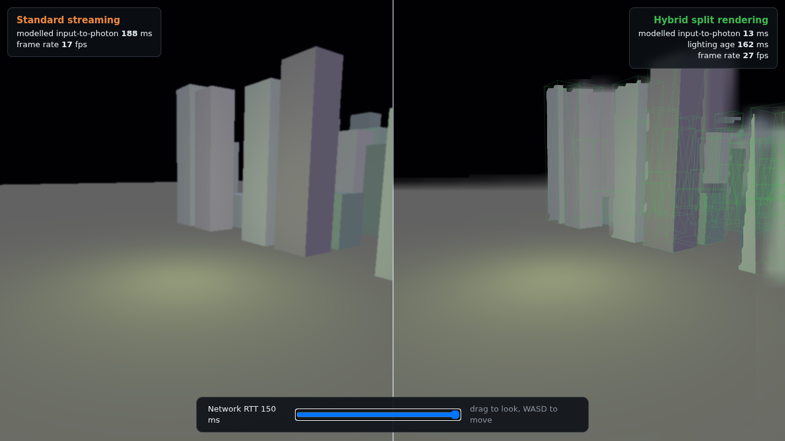
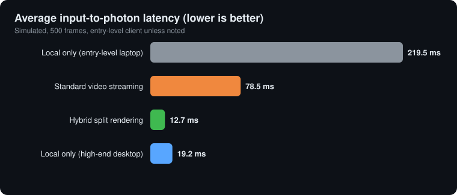

# cloud-split-render

Cloud streaming ships finished frames, so every camera move waits a full network round trip. This project splits the renderer instead: the client keeps the camera, proxy geometry and HUD, and the server sends only lighting, which tolerates being a few frames old. Camera latency then stops depending on the network. In the simulation below, input-to-photon latency drops from 78.5 ms to 12.7 ms; this is a model result, and the codec timings are the only real measurements so far.

**[▶ Live demo: drag the RTT slider](https://shyamal5912.github.io/cloud-split-render/)** · [Design notes](docs/architecture.md)

[](https://github.com/shyamal5912/cloud-split-render/actions/workflows/ci.yml)
[](LICENSE)



## How it works

```
        CLIENT (weak iGPU)                                           SERVER (big GPU)
        ──────────────────────────────────────────────────        ───────────────────────
 input ─► poll + predict pose ──── pose + input (uplink) ─────────► world simulation
              │                                                          │
              ▼                                                          ▼
        proxy geometry, depth                                      full G-buffer
        (always current)                                           ray-traced lighting
              │                                                          │
              │            ◄── lighting delta packets ─── delta encode
              ▼                 each tagged with the pose it was
        reproject lighting      rendered for
        onto the *current* pose
              │
              ▼
        tonemap ─► native-res HUD ─► screen
```

Stages are assigned by a small partitioner ([`server/python/partitioner.py`](server/python/partitioner.py)): anything the player feels immediately (input, camera, edges, HUD) stays local if it fits the GPU and VRAM budget; anything expensive and smooth (global illumination, shadows, world simulation) stays on the server.

## Measured results

What has actually been measured is the lighting delta codec, on the CPU of the machine that ran [`benchmarks/codec_bench.py`](benchmarks/codec_bench.py) (2 vCPU cloud VM, Python + numpy, synthetic data). Lighting buffer 320×180×3 = 172,800 cells; a full keyframe is 154.5 KiB. Gaps between changed cells are stored as u16, deltas as int8 (int16 when a change exceeds ±127), and the stream is zlib level 1.

| Cells changed per frame | Packet size | Bandwidth at 60 fps | Encode | Decode |
|---:|---:|---:|---:|---:|
| 1% | 3.0 KiB | 1.5 Mbps | 0.72 ms | 0.18 ms |
| 5% | 12.4 KiB | 6.1 Mbps | 1.03 ms | 0.31 ms |
| 20% | 38.1 KiB | 18.7 Mbps | 1.89 ms | 0.71 ms |
| 50% | 79.7 KiB | 39.2 Mbps | 3.76 ms | 1.45 ms |

Versus the first version of the codec (absolute indices, structured arrays), packets are 30-50% smaller and encode is up to 2x faster. Sparse deltas stay small only while little of the lighting changes per frame; real bandwidth depends on the game. Values are quantised to 1/32 and the encoder tracks exactly what the client reconstructs, so error does not accumulate: max drift stays at 0.016 even in a random-walk stress test (`test_no_drift_over_many_frames`).

## Simulated comparison

> **Simulation, not hardware measurement.** [`simulator.py`](server/python/simulator.py) adds up assumed per-stage costs (input 3.5 ms, encode 12 ms, decode 8 ms, scanout and so on) over 500 frames at a mean 38 ms RTT with jitter and queueing spikes. Seed is fixed, so the numbers reproduce. They show what the architecture would do *if* those assumptions hold.



| Configuration | Avg FPS | 1% low FPS | Input-to-photon | p99 | Bandwidth | Client VRAM |
|---|---:|---:|---:|---:|---:|---:|
| Local only, entry-level laptop | 7.5 | 3.9 | 219.5 ms | 390.8 ms | 0 | 1850 MB |
| Standard video streaming | 57.2 | 20.2 | 78.5 ms | 93.6 ms | 18.5 Mbps | 320 MB |
| **Hybrid split rendering** | **59.9** | **50.0** | **12.7 ms** | **13.6 ms** | **9.4 Mbps** | 525 MB |
| Local only, high-end desktop | 113.8 | 94.6 | 19.2 ms | 20.3 ms | 0 | 11400 MB |

Hybrid latency has no RTT term by construction (camera and HUD are local); what grows with RTT is the age of the lighting. Bandwidth and VRAM columns are model inputs, not outputs. Rerun with your own numbers: `python server/python/simulator.py --rtt 80`. The demo's millisecond readouts come from the same model.

## Quickstart

Simulator and tests (Python 3.10+):

```bash
python -m venv .venv && source .venv/bin/activate
pip install -r requirements.txt -r requirements-dev.txt
python server/python/simulator.py          # prints the plan + modelled table
python benchmarks/codec_bench.py           # measured codec timings
python server/python/simulator.py --rtt 120 --frames 2000
pytest -q
```

Streaming server (stdlib asyncio, one encoder per client, slow clients are skipped and resynced with a keyframe, clean SIGTERM shutdown):

```bash
python server/streaming/server.py --port 9000 --fps 60
# or
docker build -t split-render . && docker run -p 9000:9000 split-render
```

Browser demo (no build step; Three.js loads from a CDN):

```bash
python -m http.server 8000 --directory client
# open http://localhost:8000
```

Left pane: whole frames arrive late, drop under load and smear when the camera moves fast. Right pane: the "server" renders colour and depth from an RTT-old camera; the client reprojects that frame to the live camera with the depth buffer ([`reproject.vert.glsl`](client/shaders/reproject.vert.glsl)), discards triangles stretched across depth edges, fills the holes from a blurred copy of the frame, and overlays its own wireframe proxy at the live pose. Drag to look, WASD to move, or leave it alone for an automatic whip-pan.

## Layout

```
client/       browser demo: Three.js scene, camera pose history, GLSL shaders
server/
  python/     stage partitioner and latency simulator
  streaming/  delta codec and asyncio streaming server
benchmarks/   codec benchmark, plus modelled summary.csv
docs/         design notes
tests/        partitioner, codec and simulator tests
```


Licensed under AGPL-3.0.